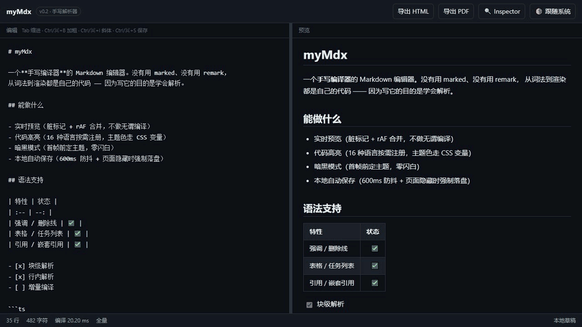

# myMdx

一个 Markdown 编辑器。**但真正的目的是把「解析」这件事完整走一遍**：词法、块级解析、行内解析、渲染、增量编译，全部自己写。

所以运行时依赖只有 `vue` 和 `highlight.js` —— 没有 `marked`，没有 `remark`，没有 `unified` 生态。



<sub>录自真实页面：输入时状态栏的「增量 10/12」= 复用 10 个块、只重解析 2 个；打开 Inspector 能看到光标所在段落的 token 流、整篇 AST 和分段耗时。</sub>

```bash
npm install
npm run dev      # http://localhost:5173
npm test         # 54 条断言
npm run build
$env:BENCH=1; npx vitest run tests/bench.test.ts   # 性能对照表（Windows PowerShell）
```

---

## 为什么重写一个解析器

「调 `marked.render(md)`」写完只要三行，但它考的是 API 记忆，不是解析。这个项目要的是：

- 手写编译器内核：字符状态机 Lexer → 递归下降 Block Parser → 分隔符贪心配对的 Inline Parser → 渲染器；
- 每一步都产出**带源码位置**的 AST，位置信息同时喂给增量编译、Inspector 跳转、未来的滚动锚点；
- 增量编译：单次按键只重解析脏窗口，其余顶层块直接复用。

`marked` 仍然在项目里 —— 作为 `devDependency` 的**差分测试基准**（同源码、两个解析器、比标签序列）。这比自己写个壳去调它更有说服力。

---

## 架构

```
           ┌──────────────── useMarkdown（单例状态）────────────────┐
 textarea ─┤ content ──rAF 合并──▶ IncrementalCompiler.parse        │
           │                          │                             │
           │       ┌──────────────────┴─────────────────┐           │
           │       │ 1. CRLF 归一化                     │           │
           │       │ 2. 引用定义收集（等长空白消隐）     │           │
           │       │ 3. 前缀/后缀扫描 → 脏窗口          │           │
           │       │ 4. 窗口独立解析（前后各带守卫块）   │           │
           │       │ 5. 拼接 + 复用块位置平移            │           │
           │       └──────────────────┬─────────────────┘           │
           │                          ▼                             │
           │                     BlockNode[]（shallowRef）          │
           │                          │                             │
           │      renderBlocks(AST) ──┼──▶ v-html 预览              │
           │                          └──▶ standaloneHtml 单文件导出 │
           └────────────────────────────────────────────────────────┘
```

四段管线：

| 阶段 | 文件 | 做什么 |
|--|--|--|
| 归一化 / 定义收集 | `src/core/index.ts` | CRLF → LF；抽出 `[label]: url "title"` 并把它替换成**等长空格**（不是删掉），保证所有偏移仍指向用户原始源码 |
| 块级解析 | `src/core/block-parser.ts` | 递归下降 + 行游标；容器用**递归**表达而不是 CommonMark 的容器栈 |
| 行内解析 | `src/core/lexer.ts` → `inline-parser.ts` | 先扫成扁平 token 流，再用「closer 向左找最近合法 opener」的贪心配对建树 |
| 渲染 | `src/core/renderer.ts` | 输出 HTML 字符串，链接协议白名单，`data:` 只放行图片 |

---

## 性能

同机（Windows / Node 22 / 单次编辑 = 文档中间插一个字符），`src/core` 纯解析，无 DOM：

| 文档 | 顶层块 | 全量解析 | 增量解析 | 倍数 | 渲染 |
|--|--|--|--|--|--|
| 10KB | 340 | 7.52ms | 0.91ms | 8.3x | 1.8ms |
| 49KB | 1644 | 15.93ms | 1.25ms | 12.7x | 6.1ms |
| 98KB | 3268 | 21.56ms | 1.87ms | 11.5x | 5.9ms |
| 293KB | 9592 | 64.65ms | 4.05ms | 15.9x | 28.8ms |

98KB 文档的一次按键：复用 3265 块，重解析 3 块，窗口 111 个字符。

### 三个关键取舍

**1. 脏窗口边界不能按空行切。**
取「上一次解析中容器栈为空」的顶层块边界，前后各带一格守卫块。在这个位置切窗口，窗口可以用空栈独立解析，结果与全篇解析等价 —— 这是可证的，不是猜的。守卫块为什么是一格而不是两格：跨块影响（`---` 把上段变 setext 标题、删空行让两块合并）只发生在边界一格之内。

**2. 引用定义行用等长空白填充消隐。**
起初直接把定义行删成 `''`，文本长度变短，之后所有偏移整体前移 —— fuzz 第 545 轮整篇错位。改成 `' '.repeat(line.length)` 后，「消隐后的文本长度 === 原始文本长度」成为不变量，窗口可以按绝对坐标直接切。

**3. 高亮加 LRU（200 条）。**
每次按键都会重渲染整篇 HTML。没有缓存时，增量解析省下的时间会在渲染层原样花掉：几十个大代码块每次都要重跑 highlight.js。

---

## 增量编译怎么保证「快但不错」

| 机制 | 作用 |
|--|--|
| 守卫块 | 脏窗口两端各吞一格未变更块，吃掉跨块影响 |
| 自足判据 | 窗口必须停在「空行之后 + 末块不吞下文」，否则向右生长 |
| 引用定义慢路径 | 窗口里出现 `[x]: url` 行才全篇重扫（定义是全篇语义）；普通打字完全不做这次扫描 |
| 泄漏检测 | 未闭合围栏/容器/HTML 块会继续吞下文 → 窗口生长，超过 16 格回退全量 |
| fuzz 不变量 | 2000 轮随机编辑，逐块断言 `incremental(doc) === full(doc)`（位置也比） |

fuzz 一共逼出 8 个 bug，全部记在上面两个「取舍」和 `PLAN.md §4` 里。

---

## 设计决策记录

| 决定 | 放弃了什么 | 为什么 |
|--|--|--|
| 裸 `textarea` 做编辑器 | CodeMirror 6 的语法高亮/折叠/多光标 | 本期主线是编译原理，不是编辑器内核。要换也只影响一个组件 |
| 不引 diff 库 | `jsdiff` 的成熟边界处理 | 常见前后缀扫描再补 fuzz 就够了，省一个依赖和一层不可控行为 |
| 不用 `content-visibility: auto` | 屏外块零绘制 | 它会用占位尺寸撑滚动高度，而滚动同步按 `scrollTop/scrollHeight` 比例映射 —— 比例会说谎。等做了真实锚点同步再开 |
| `marked` 只当 devDependency | 少写一个解析器的时间 | 用 oracle 做差分测试，比自己写壳调它更能证明解析器正确 |
| PDF 走 `window.print()` | jsPDF + html2canvas | 浏览器自带分页与字体渲染，前端截图方案体积大、文字还不可选 |
| AST 用 `shallowRef` | `ref` 的深度响应式 | 上万个节点被递归代理一遍，开销比解析本身还大 |
| 滚动位置只在 `pagehide` 落盘 | 实时写 localStorage | 跟着 scroll 事件写 = 每秒几十次同步 IO，这是滚动发涩的典型来源 |
| 主题切换只改 `data-theme` | 重新渲染组件 | CSS 变量接管一切；且首帧前由 `index.html` 的内联脚本定主题，零闪白 |

---

## 支持的语法

ATX 标题、Setext 标题、段落、`**粗体**`/`*斜体*`/`~~删除线~~`/`` `行内代码` ``、行内链接与引用式链接（带 title）、图片、自动链接 `<https://…>`、硬换行、反斜杠转义、围栏代码块（带语言）、缩进代码块、有序/无序/嵌套列表（tight/loose）、任务列表、引用（可嵌套）、GFM 表格（含对齐）、分隔线、HTML 块、行内 HTML、引用定义，以及自定义容器：

```md
:::tip 小提示
容器的内容会和正文一样被解析。
:::
```

## 明确不做的

- **不追求完整 CommonMark 合规**：目标是「核心子集 + 明确知道自己差在哪」，不是 100% 通过规范
- HTML 块只按 CommonMark 条件 1~6 判定，条件 7（一行一个完整标签）故意不做 —— 它会误吞 `<kbd>Ctrl</kbd>` 这种行内标签
- 列表懒续行只覆盖常见形态；极复杂的交错容器（引用里套列表再套引用）可能退化成别的结构
- 不做：实体引用（`&copy;`）、脚注、定义列表、数学公式、目录、多文档管理、协作
- MDX（Markdown + JSX）不在本期 —— 那是另一个项目，见 `PLAN.md §17`

---

## 测试（54 条）

| 文件 | 内容 |
|--|--|
| `tests/parser.test.ts` | 31 条：块级/行内/安全过滤/AST 结构 |
| `tests/incremental.test.ts` | fuzz 2000 轮增量 === 全量；复用率；定义变更回退全量；未闭合围栏生长 |
| `tests/diff.test.ts` | 12 条：与 `marked` 的标签序列一致性 |
| `tests/highlight.test.ts` | 高亮产出、LRU 命中、超长块放弃 |
| `tests/export.test.ts` | 单文件导出结构、标题转义、文件名清洗 |
| `tests/bench.test.ts` | 性能对照表（`BENCH=1` 时才跑） |

---

## 目录

```
src/
├─ core/                  # 编译器（零 Vue 依赖，可在 Node 里单独测）
│  ├─ types.ts            # AST 节点定义（都带 start/end/line）
│  ├─ lexer.ts            # 字符级扫描 → 行内 token 流
│  ├─ inline-parser.ts    # token 流 → 行内 AST（分隔符贪心配对）
│  ├─ block-parser.ts     # 行级递归下降 → 块级 AST
│  ├─ renderer.ts         # AST → HTML（含协议白名单）
│  ├─ incremental.ts      # 块级增量编译
│  ├─ highlight.ts        # highlight.js 按需注册 + LRU
│  ├─ export.ts           # 单文件 HTML / 打印样式
│  └─ index.ts            # 归一化 + 定义收集 + 对外的 parse/render
├─ composables/           # useMarkdown / useTheme / useInspector
├─ styles/                # theme.css / markdown.css / print.css
└─ App.vue                # 双栏 + 分隔条 + Inspector + 状态栏
```

## 重新录制演示

上面的 GIF 是驱动真实 Edge 操作真实页面录的，不是手拼的动画。改了 UI 就重录：

```bash
npm run dev                                  # 另开一个终端，保持运行
npm i -D puppeteer-core                      # 用系统已装的 Edge，不下载 Chromium
node scripts/demo.mjs                        # 逐帧截图到 docs/frames/
python scripts/gif.py                        # 合成 docs/demo.gif（需要 Pillow）
```

帧序列写在 `scripts/demo.mjs` 里，改剧本就是改那几行；`docs/frames/` 是一次性产物，已 gitignore。

## 还想要什么

README 里那张性能表是自动生成的（`tests/bench.test.ts`），文档再长也不用重测手工数字。接下来按成本排序：TOC 侧栏（AST 现成）→ 图片粘贴内嵌 → 真实滚动锚点 → 插件式语法扩展（`:::note` 已经铺路）→ CodeMirror 编辑区。
